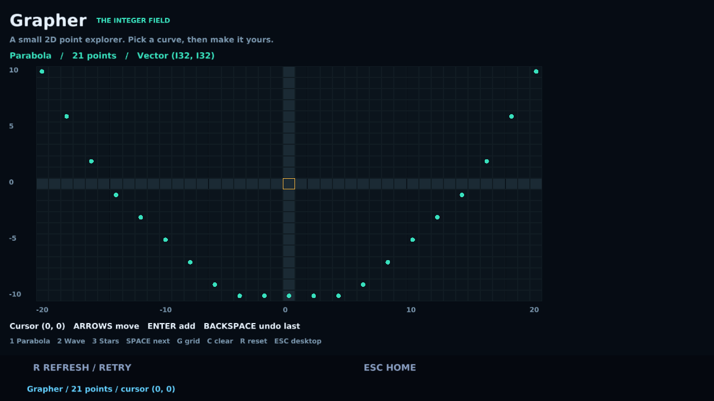

# Grapher

A small FP-RISC CLI and QOS desktop application that plots **`Vector (I32, I32)`** points. Built and tested on macOS ARM64 using Homebrew FP-RISC 0.12.0 and QOS Portable 0.2.0, with the original compiler and OS source checkouts absent.



## Run

Install the toolchains from the [Homebrew tap](https://github.com/hyperswine/homebrew-tap), then clone this project:

```sh
brew install hyperswine/tap/fprisc hyperswine/tap/qos-portable
git clone https://github.com/hyperswine/grapher.git
cd grapher
```

From this directory:

```sh
./grapher test                         # language, compiler refusal and CLI checks
./grapher demo parabola                # ASCII parabola; also wave and stars
./grapher plot -6,4 0,0 5,-3 12,8       # your own I32 points
./grapher desktop                      # build, install and open the desktop app
./grapher gui-check                    # automated graphical checks and screenshots
./grapher frame-check                  # recheck existing captured frames in Sol
```

The launcher builds the native CLI when its sources change. The desktop command builds `desktop/build/grapher.qa`, creates `build/grapher.disk` on first use, installs Grapher, and launches the installed QOS desktop. Select **Grapher** and press Enter; End selects its tile on this dedicated disk. Escape returns to the desktop; Q quits from home.

The apps use the fixed inclusive viewport **x = -20..20, y = -10..10**. The CLI accepts the full I32 parser range and clips offscreen points. Its parser also accepts I32 hexadecimal bit patterns. Desktop editing is bounded to the visible viewport.

## Desktop controls

| Key | Action |
| --- | --- |
| 1 / 2 / 3 | Parabola / triangle wave / constellation |
| Space | Next dataset |
| Arrow keys | Move the highlighted coordinate cursor |
| Enter | Add a point at the cursor; duplicate coordinates stay unique |
| Backspace | Remove the last point |
| G | Toggle the grid |
| C | Clear all points |
| R | Reload the selected sample |
| Escape | Return to QOS home |

Point edits last for the current app session. The dedicated disk retains the installed application. Use `lib/points.fpr` to change the sample data, or call the desktop module's `plot` function with a linear tuple vector. `plot` consumes the vector into an immutable rendering snapshot; the event model holds an immutable list between frames.

## Language checks

The CLI checks actual outcomes and exits nonzero on failure. Its coverage is scoped to the installed native Base toolchain and installed QOS desktop SDK.

| Area | Checks |
| --- | --- |
| I32 | Wrapping arithmetic, bit operations, conversions, parser errors, typed tuple coordinates |
| Type features | Parametric polymorphism, parameterized sum types, exhaustive matching, `Sig`/`Struct` specialization over Int and String |
| Type-derived metadata | Checked `@Model.zoom` paths, generated schemas, typed field decoding |
| Proof and contracts | Numeric/structural termination measures, refinement preconditions, verified work/allocation bounds |
| Ownership | Generic identity over owned vectors, typed reads and maps, consuming conversions, explicit free, linear string builders |
| Functions and data | Capturing closures, partial application, pipelines, immutable record updates, deep equality, JSON roundtrips |
| Actors | Explicit dynamic-mailbox policy, correlated point-transform request/reply, expired deadlines, acknowledged shutdown, dead receivers, bounded parallel work with ordered results |
| Compiler refusals | Mixed I32/Int arithmetic, wrong vector elements, use after consumption, generic duplication, discarding owners, invalid type paths, missing case arms, nondecreasing measures, false resource bounds, incomplete structures used through a signature, wrong function arguments, unmeasured recursion |

Refinement violations are a **runtime refusal** in this release when a precondition is not discharged. The suite builds and executes that failing program separately, and requires exit 1 with the expected precondition diagnostic.

## Verified results

- 25 native runtime checks.
- 12 compiler-refusal checks, each requiring a relevant diagnostic rather than a syntax error.
- 1 runtime refinement-refusal check.
- 9 CLI integration checks, including exact plots compared with an independent Sol reference, empty/duplicate/boundary/offscreen points, and invalid input exit codes.
- 8 graphical workflow checks and 6 captured-frame checks. The frame checker counts plotted dots and validates their positions against independent coordinate fixtures, including the empty plot and a newly added point.

Machine-readable reports and logs are in `evidence/`. The test scripts run in **Sol**, using structured process APIs, exact byte I/O, and JSON reports. `tests/frames.sol` targets QOS's default 1280×720 capture. Its scanline connected-component checker validates the point positions without a Python or image-processing library. The screenshots were also visually inspected. These runs used the installed packages; no original source checkout or Homebrew installation was modified.

The GUI test owns its QOS process group through `Proc.start`/`Proc.wait`; Sol cleans up the group on failure or interruption. It uses an ephemeral network port and a temporary disk. Exact binary evdev key events are sent through a named pipe, and macOS `sips` exports PNG screenshots. Test output/log writes use immediate I/O because later processes must see them before Sol's transaction commits. Sol cache and recovery state stay in the ignored `.cache/` directory.

## Files

| Path | Purpose |
| --- | --- |
| `lib/points.fpr` | Shared I32 point vectors, samples, translation, parsing, statistics and ASCII rendering |
| `cli/main.fpr` | CLI commands and exit statuses |
| `cli/features.fpr` | Native feature checks and actor service |
| `desktop/main.fpr` | QOS app state, keyboard editing and 2D rendering |
| `desktop/qos.toml` | Installed SDK app manifest |
| `tests/check.sol` | CLI integration and expected compiler/runtime refusals |
| `tests/gui.sol` | Owned desktop process, binary input injection and frame capture |
| `tests/frames.sol` | Rendered-point verification entry point |
| `tests/framecore.sol` | Binary PPM parser and scanline connected components |
| `tests/support.sol` | Shared assertions, process execution, byte I/O and JSON reports |

The native CLI is `build/grapher`; the desktop archive is `desktop/build/grapher.qa`. The project scripts require the Homebrew `fpr`/`sol` commands, Make and Xcode Command Line Tools. The QOS formula's own wrapper still uses its bundled Python dependency and supplies its matched LLVM/lld tools. Generated binaries, disks and Sol cache/state are ignored by Git.
